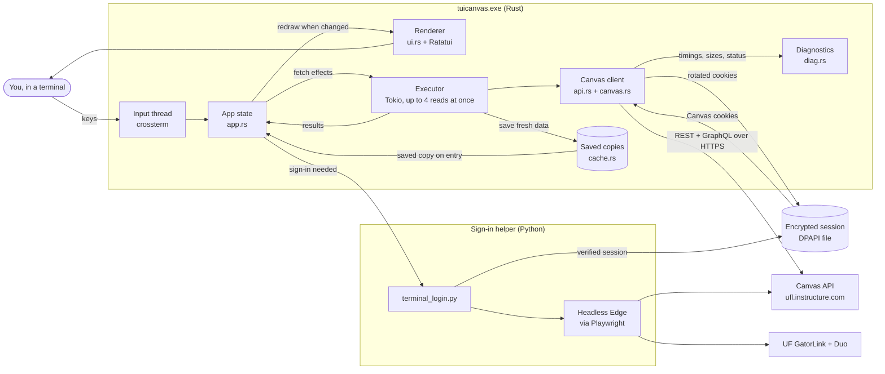
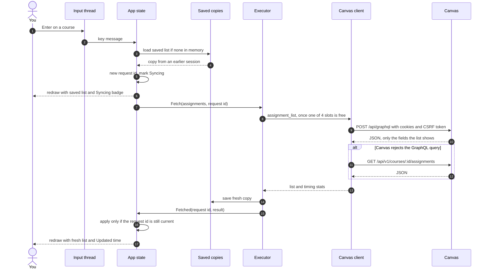
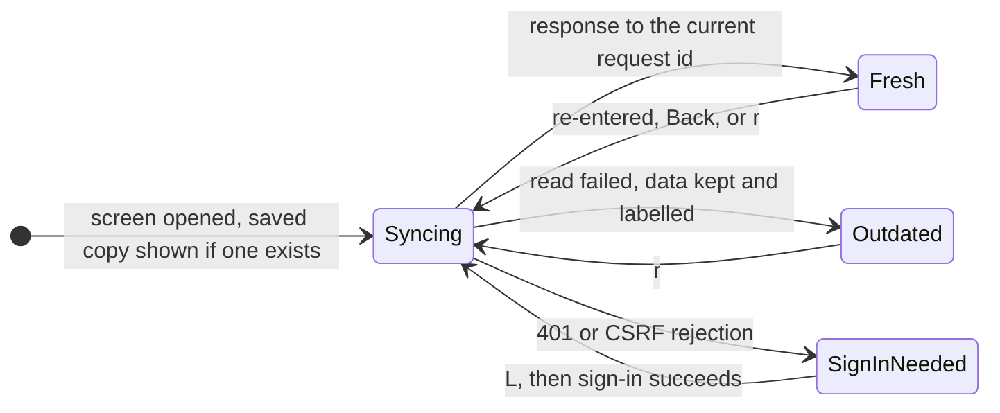
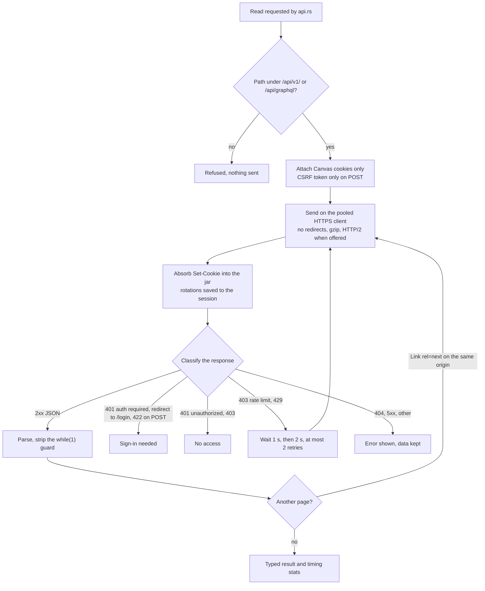
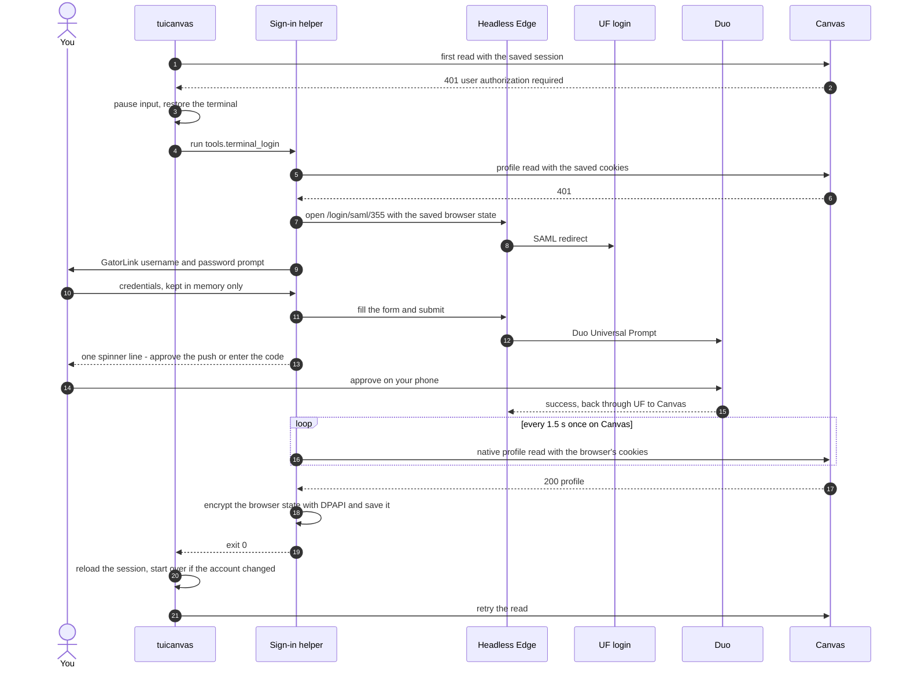

# Architecture

How TUICanvas works today: the pieces, how a screen gets its data, how sign-in works, and which optimizations are in place. Progress and next steps are tracked separately in [status.md](status.md); every network read is justified in [request-policy.md](request-policy.md).

TUICanvas has two programs:

- **`tuicanvas.exe` (Rust).** The reader you use. It draws the terminal UI and makes read-only Canvas API calls directly over HTTPS. It never loads the Canvas web app.
- **The sign-in helper (Python, `tools/terminal_login.py`).** It runs only when a session is missing or expired. It drives UF's normal GatorLink + Duo login in a hidden Microsoft Edge window from the terminal, checks the result, and saves the session for the reader.

The two share one file: the session, encrypted with Windows DPAPI at `%LOCALAPPDATA%\TUICanvas\ufl.session.dpapi`.

## Overview

## Components

| Piece | File(s) | Responsibility |
| --- | --- | --- |
| Entry point | `src/main.rs` | Command-line options: reader, `--login`, `--logout`, `--diag`, `--smoke`, `--dump` |
| Configuration | `src/config.rs` | Canvas origin (default `https://ufl.instructure.com`, override with `TUICANVAS_ORIGIN`); data, session and cache paths; finding the sign-in helper |
| Session | `src/session.rs`, `src/protect.rs` | Decrypt and encrypt the shared session with DPAPI, preserving every field the helper wrote. A small cookie jar matches domain, path and expiry, and absorbs `Set-Cookie` rotations. It also extracts the CSRF token. |
| Transport | `src/transport.rs` | One pooled `reqwest` client: HTTPS only, no redirects, timeouts, gzip, HTTP/2 when the server offers it, 16 MB response cap. Behind a trait so tests use a scripted fake. |
| Canvas client | `src/canvas.rs` | Allowlisted paths, cookies and CSRF, error classification, throttling back-off, pagination, GraphQL error handling |
| Reads | `src/api.rs` | The reviewed read operations: courses (REST), assignment list (GraphQL with REST fallback), assignment detail (REST), profile |
| Model | `src/model.rs` | Typed courses, assignments and submissions; the status shown for each assignment (Missing, Submitted late, Graded 9/10, …) |
| Saved copies | `src/cache.rs` | Versioned JSON snapshots per Canvas origin and account, written atomically |
| App state | `src/app.rs` | Pure state machine. Messages in (keys, fetch results, ticks); effects out (fetch, open URL, sign in). Owns navigation, filtering and freshness rules. |
| Runtime | `src/tui.rs` | Terminal setup and restore, input thread, async executor, sign-in handoff, headless `--dump` mode |
| Rendering | `src/ui.rs`, `src/theme.rs`, `src/html.rs` | Screens, colours, description HTML to terminal text |
| Diagnostics | `src/diag.rs` | Endpoint templates, status, bytes and timings; optional JSONL log. Never URLs with ids, headers or bodies. |
| Live check | `src/smoke.rs` | Read-only verification against Canvas that writes a metadata-only report |
| Sign-in helper | `tools/terminal_login.py`, `tools/auth_ui.py`, `tools/auth_session.py` | Browser-driven login, the one-line status display, DPAPI save, native verification |

## Reading a screen

Every screen follows the same pattern. Show what is already known immediately, start one fresh read, and replace the screen only with the result of the latest read. This example opens a course's assignment list:

Network calls and JSON parsing run on Tokio worker threads; the UI thread only updates state and draws. The one exception is reading a saved copy, a small local JSON file read on the UI thread when a screen opens.

## Freshness rules

These follow the rules approved in the build plan. A saved copy may be shown, but every visit still triggers a fresh read, and nothing pretends to be current when it isn't.

- **Every access reads again.** Opening a screen, going Back to it, or pressing `r` starts a new read.
- **Two-second reuse.** If an equivalent read started less than 2 seconds ago is still in flight, it satisfies the new access instead of being duplicated. An older in-flight read does not.
- **Latest wins.** Each read carries a request id, and a response is applied only if its id is still the newest for that resource. A slow older response can never overwrite newer data.
- **Failures never hide.** A failed read leaves the previous data on screen, marked **Outdated** with the reason.
- **Sign-in.**
  - An expired session found at startup opens sign-in directly.
  - One that expires mid-session shows a banner and waits for `L`.
  - Lacking access to one item ("no access", "not found") never triggers a sign-in.

## The request path

GraphQL responses that contain any `errors` entry fail the whole read, so a partial response never replaces good data. A list with a failed page also fails as a whole rather than appearing complete.

## Signing in

Details that matter:

- **Credentials.** They exist only in the helper's memory long enough to fill UF's form. They are never logged or saved, and never sent anywhere except UF's login page.
- **Which pages are trusted.**
  - The helper only follows pages on UF's login host, Duo, and Canvas.
  - Known Duo screens (push, Verified Push code, "Is this your device?") are shown as one status line.
  - Unknown challenges are shown in full with their real options rather than guessed at.
  - Canvas pages are never presented as prompts.
  - A page read is thrown away if the browser moved on while it was being read.
- **Completion is checked natively.** The helper confirms sign-in with a direct API read, not by looking for something on the Canvas page, because Canvas changes its pages.
- **What gets saved.** The whole Playwright storage state, so UF and Duo cookies survive for the next browser login. The reader only ever sends cookies that belong to Canvas.

## Rendering

- **Event-driven.** The screen redraws only when state changed (a key, a result, a resize). With nothing loading, the main loop blocks on its message channel and uses no CPU. While the current screen syncs, a 150 ms tick animates the badge.
- **Coalesced.** All messages waiting in the channel are applied before drawing once.
- **Visible rows only.** Lists build table rows just for the visible window around the selection, however long the list is.
- **Descriptions are converted once.** Assignment HTML becomes wrapped terminal text once per assignment version and terminal width. Scrolling reuses that text and styles only the lines on screen.
- **Untrusted text is cleaned.** Escape sequences, control characters and bidirectional overrides are removed from everything Canvas returns before it reaches the terminal.

## Optimizations in place

| Optimization | Where | Effect (measured where noted) |
| --- | --- | --- |
| Skip the web app entirely | whole design | The Canvas assignment page made 183 requests (1.4 MB) and fetched its data ~3.3 s after navigation began. The reader makes one read per screen: courses ≈22 KB, assignment detail ≈4 KB. |
| Field-selected GraphQL for assignment lists | `api.rs` | Across 17 courses: 64–75 KB instead of 944 KB, median ≈300 ms instead of ≈600 ms per course, worst case 1.9 s instead of 9.6 s. Verified identical data on all 157 assignments. |
| REST kept where GraphQL gains little | `api.rs` | A minimal GraphQL detail query saved 30–70 ms (median 183 ms vs 213–252 ms on a 4 KB response), so the documented REST read stays |
| Saved copy shown instantly, then refreshed | `app.rs`, `cache.rs` | Revisited screens appear with no network wait; freshness still guaranteed by the re-read |
| Reuse of a just-started read | `app.rs` | Quick back-and-forth within 2 s does not issue duplicate requests |
| Latest-request-wins | `app.rs` | No wasted redraws or wrong data from slow, superseded responses |
| One pooled HTTPS client | `transport.rs` | Connections (TLS handshakes) are reused across screens; gzip; HTTP/2 negotiated when offered |
| Largest page size | `api.rs` | `per_page=100` and `first: 100`: every course list and assignment list so far fits in one request |
| Bounded concurrency | `tui.rs` | At most 4 reads at once, so the reader never floods Canvas |
| Throttling back-off | `canvas.rs` | Honors Canvas rate limiting (1 s, then 2 s) instead of failing or hammering |
| Off-thread network and parsing | `tui.rs` | Keys stay responsive while reads are in flight |
| Event-driven, coalesced redraws | `tui.rs` | Zero CPU when idle; one draw per batch of changes |
| Visible-rows-only tables | `ui.rs` | Drawing cost does not grow with list length |
| Description converted once per width | `ui.rs`, `html.rs` | Scrolling never re-parses HTML |
| Local filtering | `app.rs` | `/` filters loaded rows without any request |
| Session reuse and cookie rotation | `session.rs`, `tui.rs` | No browser and no Duo while the session is valid; rotated cookies are saved back |
| Native sign-in check | `terminal_login.py` | Sign-in finishes as soon as Canvas accepts the session, without waiting on page elements |
| Release build tuning | `Cargo.toml` | Thin LTO; debug info stripped |

Sizes are of the decompressed JSON bodies. Timings come from `tuicanvas --smoke` runs on one account and home connection (see [request-policy.md](request-policy.md)).

## Not applied yet

- **Prediction / prefetch** (Milestone 5): fetching an assignment's detail after its row stays selected for about 150 ms. The approved 2-second freshness rule is already in place for it to use.
- **Conditional requests** (`If-None-Match`): Canvas sends validators, but whether it honours them for these reads, and saves anything, is unmeasured.
- **Longer-lived caching** of resources that rarely change (for example, the course list) without re-reading on entry. This needs a per-resource decision (Milestone 4).
- **A measured comparison with the Canvas website** for the whole workflow (Milestone 3).
- **Rust-native sign-in,** which would remove the Python, Playwright and Edge dependency.

## Safety properties

- **Read only.** The only POST is the reviewed GraphQL list query; nothing writes to Canvas.
- **Allowlisted paths.** Requests go only to `/api/v1/` and `/api/graphql` on the configured origin. Pagination links must stay on that origin and path. IDs are validated before they go into a URL.
- **Cookies stay scoped.** Identity-provider cookies are never sent to Canvas, and the CSRF token is sent only on POST.
- **Browser opens stay on Canvas.** `o` opens only URLs on the configured Canvas origin.
- **Per-account copies.** Saved copies are separated by Canvas origin and account; `--logout` deletes the session and that account's copies.
- **No content in diagnostics.** Diagnostics, smoke reports and the helper's report contain statuses, sizes and timings only. Raw captures and reports stay in git-ignored folders.

## Development tooling

| Tool | Use |
| --- | --- |
| `cargo test`, `python -m unittest tools.test_*` | Unit tests with a scripted transport, synthetic sessions and replayed Duo screens; no network, credentials or MFA |
| `tuicanvas --smoke` | Live read-only verification and measurement → `benchmarks/private/smoke.json` |
| `tuicanvas --dump DIR` | Walks courses → course → assignment headlessly and writes each rendered screen as text, with render and sync timings |
| `tuicanvas --diag` | Logs every request's template, status, size and timing to `%LOCALAPPDATA%\TUICanvas\diagnostics.jsonl` |
| `scripts/check.ps1`, `scripts/watch.ps1` | Build, test, live checks and git tasks on Windows, on request |
